# 阿杜的 AI 剪辑 Skill

> **全系列模板已升级为面向 AI 创作的 MotionGit `.motion` 开放格式。**
>
> **[前往 MotionGit 下载最新模板 →](https://motiongit.com/@adunext)**
>
> **下载后，直接把 `.motion` 文件发给 AI 助手，再提供你的口播、文案或素材，即可开始创作。**

<p align="center">
  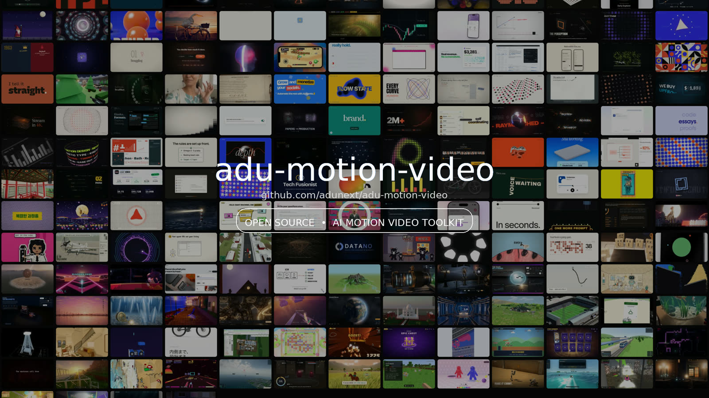
</p>

阿杜实验室出品，精选由阿杜与 Opus 5.5 制作的动画动效模板。选喜欢的风格，用 **Codex / Claude Code** 等助手，把自己的口播、文案与素材制作成视频，适合口播、知识讲解与方法分享。更多类型的模板和助手适配持续进行中。

**`.motion` 是给 AI 使用的完整动画模板包，不是提示词，也不是参考视频。** 它把代码级动画、画面布局、时间轴、转场、音效编排，以及可替换内容、使用引导和运行说明放在一个文件里。助手读取模板后，按你的内容安排镜头、替换素材、生成预览，再导出 **MP4 与可编辑工程**。后续可以继续改文案、调节奏、换素材，复用同一风格制作下一期。

MotionGit 是面向 AI 视频创作的开放格式与模板协作平台。新版模板的效果预览、横竖屏版本和后续更新，统一在 [阿杜的 MotionGit 主页](https://motiongit.com/@adunext)查看和下载；制作以所下载模板的说明与实际能力为准。

[下载最新 `.motion` 模板](https://motiongit.com/@adunext)　·　[如何开始](#开始创作)　·　[查看风格](#模板库)　·　[MotionGit 使用指南](https://motiongit.com/use)

已有旧版源码安装时，先按[源码更新说明](references/source-updates.md)从新副本运行 `update-source`；保留现有工程、参数、Key 和无关源码改动。新版 `.motion` 包继续使用各自的官网升级入口。

---

## 模板库

**6 类主要风格。** 以下保留本仓库的风格示例，每行最多展示 3 个预览。新版 `.motion` 的完整效果、样式分支与横竖屏下载，请前往 [MotionGit 模板主页](https://motiongit.com/@adunext)。

### 01 · 现代图文口播

> **横屏 ✓ · 竖屏 ✓**

清爽文字、图解与真人窗口，配合节奏强调、连续形变、纵深舞台和分屏交接。适合知识讲解、工具演示、观点拆解与方法分享。

<table>
  <tr>
    <td align="center" width="256"><a href="https://adunext.github.io/adu-motion-video/examples/gallery/?template=01-A">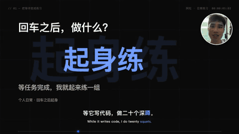</a><br><strong>01-A</strong><br><sub>原片节奏</sub><br><a href="https://adunext.github.io/adu-motion-video/examples/gallery/?template=01-A">▶ 播放示例视频</a></td>
    <td align="center" width="256"><a href="https://adunext.github.io/adu-motion-video/examples/gallery/?template=01-B">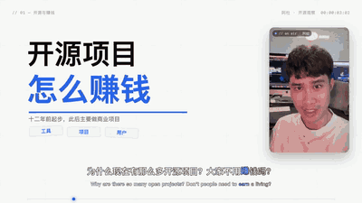</a><br><strong>01-B</strong><br><sub>连续形变</sub><br><a href="https://adunext.github.io/adu-motion-video/examples/gallery/?template=01-B">▶ 播放示例视频</a></td>
    <td align="center" width="256"><a href="https://adunext.github.io/adu-motion-video/examples/gallery/?template=01-C">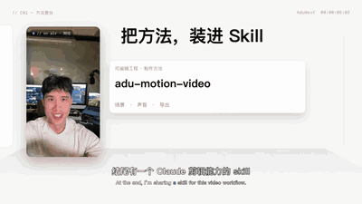</a><br><strong>01-C</strong><br><sub>纵深舞台</sub><br><a href="https://adunext.github.io/adu-motion-video/examples/gallery/?template=01-C">▶ 播放示例视频</a></td>
  </tr>
  <tr>
    <td align="center" width="256"><a href="https://adunext.github.io/adu-motion-video/examples/gallery/?template=01-D">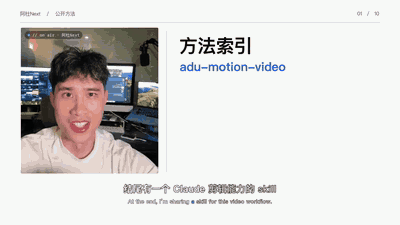</a><br><strong>01-D</strong><br><sub>杂志分屏</sub><br><a href="https://adunext.github.io/adu-motion-video/examples/gallery/?template=01-D">▶ 播放示例视频</a></td>
    <td align="center" width="256"><a href="https://adunext.github.io/adu-motion-video/examples/gallery/?template=01-E">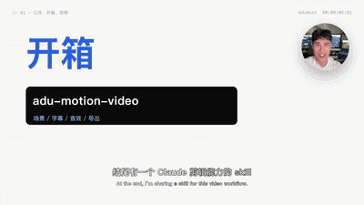</a><br><strong>01-E</strong><br><sub>节拍字效</sub><br><a href="https://adunext.github.io/adu-motion-video/examples/gallery/?template=01-E">▶ 播放示例视频</a></td>
  </tr>
</table>

---

### 02 · 纸面透视讲解

> **横屏 ✓ · 竖屏 ✓**

纸张质感、透视卡片、天平与信息网络，让抽象关系变成直观图解。适合选择对比、资料整理、流程说明与行动步骤。

<table>
  <tr>
    <td align="center" width="256"><a href="https://adunext.github.io/adu-motion-video/examples/gallery/?template=02-A">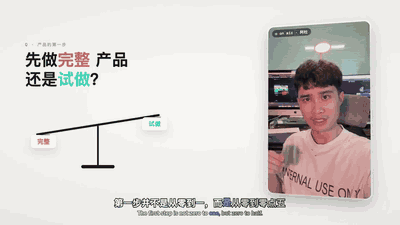</a><br><strong>02-A</strong><br><sub>纸面天平</sub><br><a href="https://adunext.github.io/adu-motion-video/examples/gallery/?template=02-A">▶ 播放示例视频</a></td>
    <td align="center" width="256"><a href="https://adunext.github.io/adu-motion-video/examples/gallery/?template=02-B"></a><br><strong>02-B</strong><br><sub>纸面聚合</sub><br><a href="https://adunext.github.io/adu-motion-video/examples/gallery/?template=02-B">▶ 播放示例视频</a></td>
  </tr>
</table>

---

### 03 · 深色 3D

> **横屏 ✓ · 竖屏 ✓**

暗色舞台、立体窗口、多屏展陈与镜头推进，突出作品细节与视觉层次。适合产品演示、软件评测、成果比较与作品集。

<table>
  <tr>
    <td align="center" width="256"><a href="https://adunext.github.io/adu-motion-video/examples/gallery/?template=03-A">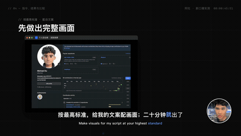</a><br><strong>03-A</strong><br><sub>多屏展陈</sub><br><a href="https://adunext.github.io/adu-motion-video/examples/gallery/?template=03-A">▶ 播放示例视频</a></td>
  </tr>
</table>

---

### 04 · 深色科技控制台

> **横屏 ✓ · 竖屏 ✓**

粒子仪器台、玻璃面板与信息流，配合输入融合、步骤展开和结果交付。适合技术讲解、自动化流程与工具实测。

<table>
  <tr>
    <td align="center" width="256"><a href="https://adunext.github.io/adu-motion-video/examples/gallery/?template=04-A">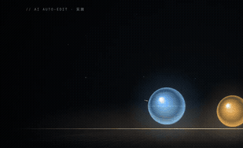</a><br><strong>04-A</strong><br><sub>仪器台演示</sub><br><a href="https://adunext.github.io/adu-motion-video/examples/gallery/?template=04-A">▶ 播放示例视频</a></td>
  </tr>
</table>

---

### 05 · 鲜色角色叙事

> **横屏 ✓ · 竖屏 ✓**

鲜色便签、角色贴纸、物件接力与光环强调，将关键词、成果和反馈串成连贯表达。适合教程交接、方法分享、成果复用与迭代说明。

<table>
  <tr>
    <td align="center" width="256"><a href="https://adunext.github.io/adu-motion-video/examples/gallery/?template=05-A">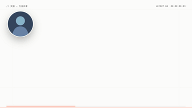</a><br><strong>05-A</strong><br><sub>角色与物件接力</sub><br><a href="https://adunext.github.io/adu-motion-video/examples/gallery/?template=05-A">▶ 播放示例视频</a></td>
  </tr>
</table>

---

### 06 · 活力色彩

> **横屏 ✓ · 竖屏 ✓（MotionGit 新版）**

纸白、红、蓝与荧光黄绿，搭配大字冲击、回声标题、步骤归一和形状变化。适合观点表达、步骤讲解、要点总结与概念性成本说明。

<table>
  <tr>
    <td align="center" width="256"><a href="https://adunext.github.io/adu-motion-video/examples/gallery/?template=06-A">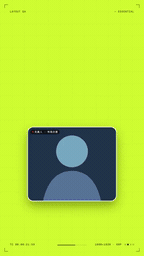</a><br><strong>06-A</strong><br><sub>原生竖屏</sub><br><a href="https://adunext.github.io/adu-motion-video/examples/gallery/?template=06-A">▶ 播放示例视频</a></td>
  </tr>
</table>

以上为本仓库的历史风格示例，部分是局部或静音演示。新版完整示例及可下载版本以 [MotionGit 主页](https://motiongit.com/@adunext)为准；需要继续维护旧版 Skill 工程时，查阅[旧版模板目录](references/template-catalog.md)。

---

## 模板特点

| 特点 | 说明 |
| --- | --- |
| **一个 `.motion` 文件** | 下载后直接交给助手，按包内引导使用，无需先手动安装整套旧版 Skill |
| **代码级完整模板** | 动画源码、布局、动作时间轴和音效编排可以按模板的运行方式制作与编辑 |
| **按内容适配** | 根据表达关系选择完整镜头组，绑定你的文字、图片、视频和口播 |
| **保持连贯节奏** | 结合动作、转场、字幕与音效安排时间，复用同一风格制作系列内容 |
| **横竖屏按需选择** | 支持情况见每套模板标记，竖屏采用对应布局 |
| **字体不阻碍制作** | 原字体优先推荐，缺失时自动使用随包中英文字体，并检查实际排版 |
| **交付可继续修改** | 输出 MP4 与可编辑工程，后续可以改文案、换素材、再导出 |

---

## 开始创作

### 推荐方式：下载 `.motion`，直接交给助手

| 步骤 | 操作 |
| --- | --- |
| **1 · 选模板并下载** | 打开 [阿杜的 MotionGit 主页](https://motiongit.com/@adunext)，先看效果，选择喜欢的风格与横竖屏版本，下载 `.motion` 文件 |
| **2 · 发给 AI 助手** | 把下载的文件直接发给助手，或提供准确的本地文件路径；再发送你的口播视频、文案或音频，有字幕、录屏、图片和配乐也可一起提供 |
| **3 · 看预览并制作** | 助手读取模板内置引导，检查素材与运行环境，按内容安排动画、字幕和声音；先看预览、继续调整，再导出 MP4 与可编辑工程 |

**平台：Windows · macOS · Linux**<br>
**助手：Codex · Claude Code · Cursor · GitHub Copilot，以及具备相应文件和执行能力的豆包 · DeepSeek · WorkBuddy 等。**

制作时使用能读取文件、执行命令的工作模式。助手名称相同，不同客户端的能力也可能不同；具体操作可查看 [MotionGit 使用指南](https://motiongit.com/use)。

> **首次使用可能需要较长时间配置制作环境。** 助手会按模板要求准备运行依赖、浏览器或视频工具；完成后可复用环境，后续制作通常不需要重复安装。原字体是优先推荐项，缺失时按模板的字体回退方案继续制作。

### 让助手引导你开始

把 `.motion` 文件连同这句话一起发给助手：

```text
请读取我提供的 .motion 模板，引导我开始创作。
先告诉我这个模板适合做什么、需要哪些素材。
我会提供自己的口播或文案，请按模板风格制作，
先给我预览，再输出 MP4 和可编辑工程。
```

已有素材可以直接一起提供；缺少的信息由助手逐步询问，不必先填写技术参数表。

### 已有素材，直接制作

```text
请用我提供的 .motion 模板制作一条竖屏视频。
口播和素材在：[我的素材文件夹路径]
请按我的文案安排动画、字幕、背景音乐和音效，
先给我预览，再输出 MP4 与可编辑工程到：[我的输出目录]。
保留原模板和素材，后续我还要继续修改。
```

横屏制作时，下载对应横屏模板并修改画幅要求即可。

### 继续使用旧版 Skill

已有旧工程或需要沿用仓库制作工具时，仍可 [下载旧版 Skill 3.14.1-rc.1](https://github.com/adunext/adu-motion-video/releases/download/v3.14.1-rc.1/adu-motion-video_3.14.1-rc.1.zip)，按[旧版创作引导](references/start-creating.md)安装和使用。新版 `.motion` 模板优先从 MotionGit 下载。

---

## 使用资料

**新版 `.motion`**：[阿杜模板下载](https://motiongit.com/@adunext)　·　[MotionGit 使用指南](https://motiongit.com/use)　·　[开放格式规范](https://motiongit.com/spec)

**旧版 Skill 与工程维护**：[模板目录](references/template-catalog.md)　·　[创作引导](references/start-creating.md)　·　[安装与制作工具](references/tooling.md)　·　[平台与字体兼容](references/compatibility.md)　·　[旧版发布记录](https://github.com/adunext/adu-motion-video/releases)

阿杜实验室 · Adu-motion-video · [MIT License](LICENSE) · [第三方说明](THIRD_PARTY.md)

### 全模板统一角标

当前旧版 Skill 的所有模板在官方静帧、视频预览及导出中，统一带右上角成片时间与动态 Circle Logo 交替，横竖屏均保留安全边距。旧工程使用新版工具重新导出即可，原文件保留。参见[角标说明](references/output-signature.md)。
